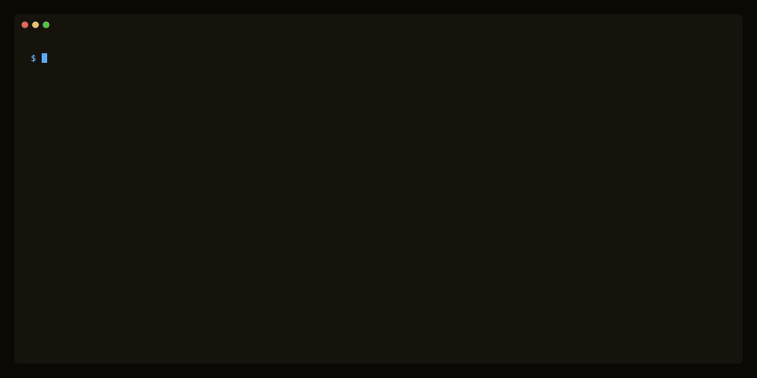

<p align="center">
  <picture>
    <source media="(prefers-color-scheme: light)" srcset="assets/brand/logo-full-on-light.svg">
    
  </picture>
</p>

<p align="center">
  <a href="https://github.com/ambierhq/skigard/releases"></a>
  <a href="https://github.com/ambierhq/skigard/actions/workflows/ci.yml"></a>
  <a href="https://scorecard.dev/viewer/?uri=github.com/ambierhq/skigard"></a>
  <a href="LICENSE"></a>
  <a href="https://github.com/ambierhq/skigard/releases"></a>
  <a href="docs/install/README.md"></a>
</p>

# skigard: lockfile and security review gate for Claude Code, Codex and Cursor agent skills

**A lockfile and review gate for agent skills:** skills installed through skigard are scanned, shown to a human and pinned to the exact bytes they approved.

<p>
  <a href="#install">Install</a> ·
  <a href="#quick-start">Quick start</a> ·
  <a href="docs/getting-started.md">Docs</a> ·
  <a href="https://ambierhq.com/skigard">Website</a>
</p>

## The problem

- Agent skills are instructions and scripts that run with **your agent's permissions**. Copying one from the internet is running someone else's code.
- Skills are fetched from moving branches: what you read yesterday is not what installs today. There is no pinning.
- Nobody reviews them, and the agent that installs a skill is the same agent a bad skill can talk into installing more.
- A prompt-injected agent can add skills on its own, so "the agent approved it" is not a control.

skigard puts a gate in front of that: **fetch to quarantine, scan, optional agent review, human approval, hash-pinned lockfile, install.**

| Without skigard | With skigard |
|---|---|
| `git clone` or copy a skill straight into `~/.claude/skills` | Fetched as an archive into a private quarantine, never executed |
| Whatever is on the branch today | Pinned to a commit and a SHA-256 content hash in `skigard.lock` |
| You skim it, maybe | A deterministic scan, an optional agent review, and a diff against what you approved before |
| An agent can install more skills | Approval needs a human at a terminal: no `--yes`, no stdin path, and agents it can detect are refused |
| A skill changes silently on update | Changes go back to quarantine and need a new approval |
| Each agent has its own skills folder | Installs once into every detected harness (Claude Code, Pi, Codex, Cursor, Gemini CLI, OpenCode and 72 more) |
| No way to notice drift | `skigard verify` fails CI if the lock, the store or the installs change |

<picture>
  <source media="(prefers-color-scheme: dark)" srcset="assets/diagrams/pipeline-dark.svg">
  <source media="(prefers-color-scheme: light)" srcset="assets/diagrams/pipeline-light.svg">
  
</picture>

<sub>Made with [Archify](https://github.com/tt-a1i/archify); the Mermaid sources stay in [assets/diagrams](assets/diagrams). `verify` and `update` branch off the lock.</sub>

<p align="center">
  
</p>

- **One static binary**, no runtime, no telemetry, one dependency (a TOML parser).
- **Approval needs a human at a terminal.** `approve` reads the terminal device only: there is no `--yes`, no stdin path and no environment variable, and skigard refuses when it detects an agent harness in its environment or among its parent processes (best effort, evadable by re-parenting). A process that creates its own pseudo-terminal can still type the answer, so the gate stops accidents and ordinary prompt injection, not a determined agent ([details](docs/threat-model.md#the-pseudo-terminal-case)). Signed approvals (a key in your OS keychain or a passkey) are planned.
- **Reproducible.** `skigard.lock` records source, commit, content hash, scan result, review and approver. Commit it.
- **Portable.** The content hash is identical on Linux, macOS and Windows.

> The scanner is heuristic and an agent review can be fooled. "Pass" is not a safety certificate. Read the skill,
> especially bundled scripts. See the [threat model](docs/threat-model.md) and
> [what skigard does not protect against](#what-skigard-does-not-protect-against).

## Install

`v0.1.1` is the latest release ([GitHub Releases](https://github.com/ambierhq/skigard/releases)). Status of each channel:

| Channel | Command | Status |
|---|---|---|
| Go | `go install github.com/ambierhq/skigard/cmd/skigard@latest` | live |
| Shell installer (macOS, Linux) | `curl -fsSL https://ambierhq.com/skigard/install.sh \| sh` | live |
| PowerShell (Windows) | `irm https://ambierhq.com/skigard/install.ps1 \| iex` | live (tested in CI on `windows-latest`) |
| GitHub Releases | archives, `.deb`, `.rpm`, `.apk`, `.pkg.tar.zst`, checksums, SBOMs, cosign signatures | live |
| Homebrew | `brew install ambierhq/tap/skigard` | live |
| winget | `winget install Ambier.Skigard` | submitted, pending Microsoft review ([winget-pkgs#484409](https://github.com/microsoft/winget-pkgs/pull/484409)) |
| Scoop | `scoop bucket add ambierhq https://github.com/ambierhq/scoop-bucket && scoop install skigard` | live, not yet tested on Windows |
| mise | `mise use -g github:ambierhq/skigard` | live (the short name `skigard` needs a registry entry, not submitted) |
| Nix | `nix run github:ambierhq/skigard` | flake builds in CI; not tested by hand |
| npx / npm | `npx skigard` or `npm i -g skigard` | not published yet |
| apt, dnf, pacman repositories | not offered. Install the `.deb`, `.rpm` or `.pkg.tar.zst` attached to a GitHub Release (see [Linux](docs/install/linux.md)) | not offered |

Per-system pages: [macOS](docs/install/macos.md) · [Linux](docs/install/linux.md) · [Windows](docs/install/windows.md) ·
[other channels](docs/install/other.md). Releases are checksummed, SBOM-ed, signed with cosign and carry GitHub build attestations
([verify them](docs/install/README.md#verify-what-you-downloaded)). The installers never use `sudo`.

### Supported platforms

| OS | Architectures | `approve` | Automated `review` | Installs as |
|---|---|---|---|---|
| Linux | amd64, arm64 | yes (`/dev/tty`) | yes (bubblewrap or Landlock) | symlinks (or `--copy`) |
| macOS | amd64, arm64 | yes (`/dev/tty`) | yes (Seatbelt) | symlinks (or `--copy`) |
| Windows 10/11 | amd64, arm64 | yes (console, `CONIN$`) | no, use `review --manual` or WSL | copies |

## Quick start

`examples/hello-skill` is a tiny skill that passes the scanner, so the whole flow runs without an override:

```sh
skigard detect                                                         # which agent harnesses are on this machine?
skigard add github:ambierhq/skigard/examples/hello-skill               # fetch into quarantine and scan: PASS, 1 file
skigard review hello-skill                                             # optional second opinion from pi / claude / omp (asks which)
skigard approve hello-skill                                            # in a real terminal: shows scan, review and diff; you type the name
skigard install hello-skill                                            # link into every detected, verified harness
skigard verify                                                         # CI-friendly: lock vs store vs installs
```

What a block looks like: this repository's own `skills/review-skill` talks *about* credentials and `curl | sh`, so the scanner blocks it
(risk 100/100, four high or critical findings, each with file, line and the matching text). `approve` refuses until you have read it and record why:

```sh
skigard add github:ambierhq/skigard/skills/review-skill
skigard approve review-skill --override --reason "reviewed by hand: it only describes risks"
```

Large skills can produce hundreds of findings; read the verdict and the counts first, then the files. A step-by-step version is in
[Getting started](docs/getting-started.md).

Update later: `skigard update` re-fetches approved skills; anything that changed goes back to quarantine with a diff.
New machine: clone your home repository to `~/.config/skigard` and run `skigard sync`.

## How to use

| Command | What it does |
|---|---|
| `init [--git]`, `detect [--all]` | create the home; list harnesses (`installed`, `configured`, `absent`) |
| `add SOURCE [--skill N \| --all]` | fetch to quarantine and scan. `SOURCE`: `github:owner/repo[/path][@ref]`, `owner/repo`, a github.com URL, or a local path |
| `scan NAME\|PATH [--format text\|json\|sarif] [--fail-on LEVEL]` | deterministic scan |
| `review NAME [--harness ID \| --manual]` | advisory agent review ([how it works](docs/review.md)) |
| `diff NAME` | quarantined vs approved |
| `approve NAME [--override --reason R] [--accept R]` | **human only** |
| `reject NAME` | delete from quarantine |
| `update [NAME...]` | re-fetch approved skills; changes go to quarantine |
| `install NAME... [--to IDS] [--scope user\|project] [--copy]`, `uninstall`, `sync` | put approved skills into harnesses, remove them, or install everything approved |
| `verify [--strict]` | lock, store, installs and marketplace agree (exit 1 if not) |
| `list`, `show`, `status`, `doctor`, `stats --tokens` | inspect |
| `plugin ...`, `marketplace build\|check` | group skills; generate a Claude Code / OMP marketplace |
| `harness list\|add`, `rules` | the harness registry and the scanner rules |
| `lock upgrade` | move older lock entries to hash v2, only where the old hash still matches |
| `completion bash\|zsh\|fish\|powershell`, `migrate --from-skm PATH` | shell completions; import from the predecessor tool |

Every command takes `--json` and `--home PATH`. Exit codes: `0` ok, `1` policy/drift/findings, `2` usage or error, `3` cancelled, `4` incomplete coverage.
Full reference: [docs/commands.md](docs/commands.md) (generated from the CLI).

### How the gate decides

1. **Scan**: [34 rules](docs/rules.md) plus capability chains. Any `high`/`critical` finding is a **block**; `medium` or incomplete coverage is a **review**.
2. **Review** (optional): an installed harness reads the files with tools off, inside an OS sandbox where one works. It can only add doubt.
3. **Approve**: you see the scan, the review and the diff, and type the skill name. A block or failing review needs `--override --reason "..."`, which is recorded forever.
4. **Install** refuses anything whose hash no longer matches the lock.

### Where things live

`~/.config/skigard` (`%APPDATA%\skigard` on Windows; override with `$SKIGARD_HOME`). It is designed to be a private git repository: `skigard init --git`.
Layout, formats and the Windows split are in [concepts](docs/concepts.md), [lockfile](docs/lockfile.md) and [Windows notes](docs/windows.md).

## CI usage

```yaml
- run: curl -fsSL https://github.com/ambierhq/skigard/releases/download/v0.1.1/install.sh | SKIGARD_VERSION=v0.1.1 sh
- run: skigard verify --strict        # with SKIGARD_HOME=./.skigard committed to the repository
```

Pin the release, never `main`. See the [CI guide](docs/ci.md) and [`examples/verify-workflow.yml`](examples/verify-workflow.yml). A reusable [`skigard-action`](https://github.com/ambierhq/skigard-action) (`v1`) wraps `skigard verify` for GitHub Actions.

## Supported harnesses

[78 harnesses](docs/harnesses.md) are in the registry. Three are verified so far (Claude Code, Pi, Oh My Pi); the rest are detected and listed but installed to
only with `--include-unverified`, until someone confirms the path. Missing yours? `skigard harness add --id mytool --name MyTool --global '~/.mytool/skills' --bin mytool`, or send a PR.

## FAQ

More in [docs/faq.md](docs/faq.md).

<details><summary><b>Does "pass" mean a skill is safe?</b></summary>

No. The scanner is heuristic and a review can be fooled. "Pass" means the rules found nothing. A human reading the skill is the control.
</details>

<details><summary><b>Does an agent review replace reading the skill?</b></summary>

No. It is a second opinion that can only raise concern. It is optional, and nothing else depends on it.
</details>

<details><summary><b>Why can't my agent approve skills?</b></summary>

An injected agent installing more skills is the threat. Approval needs a human at a terminal: there is no `--yes`, no stdin path and no environment variable, and skigard refuses inside the agent harnesses it can detect. A process that creates its own pseudo-terminal can still type the answer, so the gate stops accidents and ordinary prompt injection, not a determined agent. Signed approvals (a key in your OS keychain or a passkey) are planned. See [the pseudo-terminal case](docs/threat-model.md#the-pseudo-terminal-case).
</details>

<details><summary><b>Does it phone home?</b></summary>

No telemetry and no update check. It talks to GitHub only when you `add` or `update`. `review` sends the skill to the provider of the harness you choose; use `--manual` to avoid that.
</details>

<details><summary><b>How is it different from vercel-labs/skills?</b></summary>

[`vercel-labs/skills`](https://github.com/vercel-labs/skills) (`npx skills`) is the popular installer and discovery CLI: `add`, `find`, `use`, `check`, `update`, `remove`, `init`, `list`, a `skills-lock.json` with a content hash, and the [skills.sh](https://skills.sh) directory.

skigard can be used instead of the skills installer. It covers `add`, `update`, `remove` (`uninstall`) and `list`, and adds the gate: quarantine, a scan, an optional review, **human approval** pinned to a hash, a hash-pinned lock and `verify` for drift in CI.

What you give up today: discovery and search (`skills find`, the skills.sh directory), the `skills init` template, and one-off `skills use`. Many people will find skills on skills.sh and add them through skigard.
It is not a drop-in: the lock file is different (`skigard.lock`), and an importer for `skills-lock.json` is planned, not built (`skigard migrate` only reads `skm` repositories).
Sources are GitHub (public, or private with `GITHUB_TOKEN`) and local directories; other hosts such as GitLab are not supported yet.
</details>

<details><summary><b>How is it different from asm (luongnv89/asm)?</b></summary>

[`asm`](https://github.com/luongnv89/asm) is a scriptable skill manager with a large catalog, a TUI, `--json`/`--yes` automation and a pre-install scan, built to be driven by agents.
skigard is the opposite on one point: installing cannot be completed through a flag, a pipe or an environment variable, because approval needs a human at a terminal (a process that builds its own pseudo-terminal can still type the answer; see the [threat model](docs/threat-model.md#the-pseudo-terminal-case)). Pick asm for catalog and convenience, skigard for an auditable approval trail.
</details>

<details><summary><b>Does it work on Windows?</b></summary>

Yes, on amd64 and arm64, including `approve`. Installs are copies, and automated review is disabled (use `review --manual` or WSL). See [docs/windows.md](docs/windows.md).
</details>

<details><summary><b>What happens when a skill updates?</b></summary>

`update` re-fetches; unchanged content is "up to date", changed content returns to quarantine with a diff and needs scan, review and approval again. The installed copy stays at the approved version.
</details>

<details><summary><b>Why is my security-review skill blocked?</b></summary>

The scanner matches text, not intent, so a skill that *discusses* `~/.ssh` or "ignore previous instructions" looks like one that does it. Read it, then `approve --override --reason "..."`. This repository's own
`skills/review-skill` is such a skill.
</details>

<details><summary><b>Does it need an agent installed?</b></summary>

No. Scan, approve, lock and verify need no agent. Review does.
</details>

<details><summary><b>How do I uninstall, and how do I report a malicious skill?</b></summary>

`skigard uninstall`, then delete the binary (and the home to drop approvals). Report malicious skills to GitHub; if one gets past a rule, open an issue or PR with a defanged fixture. Flaws in skigard itself: see [SECURITY.md](SECURITY.md).
</details>

## What skigard does not protect against

- **Anyone who can write to your home as you.** Write access to `~/.config/skigard` or to a harness skills directory (`~/.claude/skills`, `~/.agents/skills`, ...) can forge an approval or add a skill without skigard being involved. skigard is a gate for the supported install path, not a sandbox for your account.
- **Forgery after the fact.** The answer is `skigard verify --strict` in CI with the home committed to a repository: a changed lock shows up as a reviewable diff ([CI guide](docs/ci.md)). Signed approvals are planned.
- **A determined agent with its own pseudo-terminal.** See [the pseudo-terminal case](docs/threat-model.md#the-pseudo-terminal-case).
- **Malicious code in a skill you approved anyway.** The scanner is heuristic and a reviewing agent can be fooled. skigard pins the bytes you approved; it does not make them safe, and it does not sandbox the skill when an agent later uses it.

## Security

Report vulnerabilities privately; see [SECURITY.md](SECURITY.md). What skigard promises, and what it does not, is in the [threat model](docs/threat-model.md).
Releases are signed (cosign, keyless), come with SBOMs, and CI is pinned and hardened (CodeQL, govulncheck, dependency review, OpenSSF Scorecard).

## Roadmap

- Install channels still to land: npm, winget (in review) and the mise registry.
- `skigard find` (#28): search skills.sh or a catalog (discovery is the main thing skigard lacks today).
- An importer for `skills-lock.json` (#29) from vercel-labs/skills.
- Verify more harnesses (each one needs a person to confirm its skills directory).
- Automated review on Windows, once the reviewer CLIs have been verified there.
- Signed approvals (approver key in the OS keychain or a passkey, signature stored in `skigard.lock`, checked by `verify --strict`), and Windows code signing.

Ideas and votes: [Discussions](https://github.com/ambierhq/skigard/discussions). Changes so far: [CHANGELOG.md](CHANGELOG.md).

## Contributing

Issues and PRs are welcome. Start with [CONTRIBUTING.md](CONTRIBUTING.md) (adding a harness, a scanner rule or a reviewer template) and the [code of conduct](CODE_OF_CONDUCT.md).
Questions: [SUPPORT.md](SUPPORT.md).

```sh
mise install && mise run check && mise run e2e
```

## Acknowledgements

skigard stands on the shoulders of others. We learned from these projects and reimplemented the ideas; no code was copied. Please go and look at them:

- [SkillGuardrail](https://github.com/T-Zevin/SkillGuardrail) by T-Zevin: quarantine-first fetching, hostile-archive handling, hash-bound baselines, atomic staged installs, capability chains.
- [SkillSpector](https://github.com/NVIDIA/SkillSpector) by NVIDIA: rule IDs, SARIF, "coverage incomplete", and the capability-stripped way of using a local agent CLI as a reviewer.
- [agent-skill-manager (asm)](https://github.com/luongnv89/asm) by luongnv89: `doctor`, `--json` everywhere, context cost reporting, harness definitions as data.
- [vercel-labs/skills](https://github.com/vercel-labs/skills) by Vercel: the map of the agent-harness landscape, the universal `.agents/skills` directory, and a deterministic content hash for a skill folder.
- [skillpin](https://github.com/nbsp1221/skillpin) by nbsp1221: a manifest and lockfile pinned to exact commits.
- The [Agent Skills specification](https://agentskills.io) for the skill format, and [BurntSushi/toml](https://github.com/BurntSushi/toml) (MIT), the one library inside the binary.

Full notices: [THIRD_PARTY_NOTICES.md](THIRD_PARTY_NOTICES.md).

## License

[MIT](LICENSE), Copyright (c) Ambier Oy.

<p align="center">Built by <a href="https://ambierhq.com">Ambier Oy</a></p>
