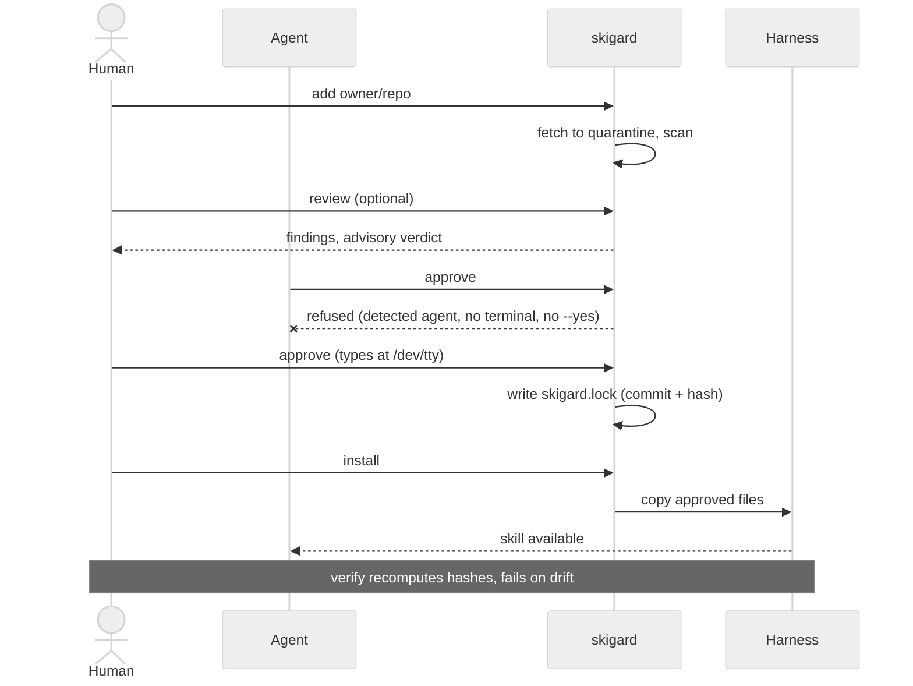

# Concepts

skigard is a pipeline with one rule: **skills installed through skigard are scanned, shown to a human and pinned to the exact bytes they approved.** It is a gate for that install path, not a sandbox for your account: see [what it does not protect against](threat-model.md#what-skigard-does-not-do).

<picture>
  <source media="(prefers-color-scheme: dark)" srcset="../assets/diagrams/pipeline-dark.svg">
  <source media="(prefers-color-scheme: light)" srcset="../assets/diagrams/pipeline-light.svg">
  
</picture>

Who does what, and where an agent it can detect is refused:



## Skill

A folder with a `SKILL.md` (YAML front matter with `name` and `description`, then instructions) and optional scripts, references and
assets, following the [Agent Skills specification](https://agentskills.io). Agents load a skill's instructions into their context and
may run its scripts with your permissions. That is why a skill is code, not just text.

## Quarantine

`skigard add` fetches into `quarantine/`, a directory with mode 0700 that is never read by an agent. GitHub sources are resolved to a full
commit SHA and downloaded as an archive (skigard never invokes `git` on skill content; only `skigard init --git` runs `git init` in your home). Extraction goes through `os.Root`, rejects links, devices, path tricks,
case-folding collisions and zip bombs, and only writes regular files. Nothing in quarantine is ever executed.

## Scan

A deterministic rule engine ([34 rules](rules.md) plus capability chains such as "reads a credential file and also makes a network call").
Severity maps to a verdict: any `high` or `critical` finding is a **block**; `medium` or incomplete coverage (binary or oversized files)
is a **review**; otherwise **pass**. "Pass" means the rules found nothing, not that the skill is safe.

## Review

Optional and advisory. A harness you already have (Pi, Oh My Pi, Claude Code) is started with tools and MCP off, in an empty directory,
with a scrubbed environment and, on macOS and Linux, inside an OS sandbox. It reads the skill from stdin and writes a verdict. The verdict
can only raise concern; it never lowers a scanner finding. Details: [review](review.md).

## Approve

The only step that needs a person. `skigard approve NAME` reads your confirmation from the terminal device (`/dev/tty`, or `CONIN$` on
Windows), never from stdin, and refuses when it detects it is inside an agent harness. A process that creates its own pseudo-terminal can still type the answer, so the gate stops accidents and ordinary prompt injection, not a determined agent. Signed approvals (a key in your OS keychain or a passkey) are planned. See [the pseudo-terminal case](threat-model.md#the-pseudo-terminal-case). You see the scan, the review and a diff against the previously
approved version, and type the name. The decision is bound to a **content hash**, recorded with who approved it and when.

## Lockfile and content hash

`skigard.lock` is TOML, sorted, and meant to be committed. Each entry records the source, commit, content hash (SHA-256 over every file's
path, length and bytes, identical on every OS, "hash v2"), an **exec set** (which files had an execute bit, with its own digest), the scan
and review results, and the approval. `install`, `sync` and `verify` recompute the hash and refuse on any mismatch. Locks written by earlier
releases keep verifying; `skigard lock upgrade` moves them to v2, only where the old hash still matches. Format: [lockfile](lockfile.md).

## Update

`skigard update` re-fetches approved skills. Unchanged content is "up to date". Anything that changed goes back to quarantine with a diff and
has to go through scan, review and approval again. An update never installs by itself.

## Harness

An agent product with a skills directory (`~/.claude/skills`, `~/.agents/skills` and so on). skigard keeps a registry of
[78 harnesses](harnesses.md), detects which are present, and installs once per shared directory. Installs are symlinks into the approved
store, or copies with `--copy` (always on Windows, and for `--scope project`). Three harnesses are *verified*; the rest need
`--include-unverified` until someone confirms the path.

## Home

```
~/.config/skigard/
├── skigard.toml        settings, plugins, custom harnesses
├── skigard.lock        approved skills pinned to hashes   (commit)
├── skills/<name>/      approved content                    (commit)
├── reviews/<name>/     evidence for each approval          (commit)
├── marketplace/        generated Claude Code / OMP marketplace (commit)
├── quarantine/         UNTRUSTED, mode 0700                (gitignored)
└── state/              install records, lock file          (gitignored)
```

Windows splits this: approved material under `%APPDATA%\skigard`, quarantine and state under `%LOCALAPPDATA%\skigard`
([Windows notes](windows.md)).

## What skigard does not do

It does not prove a skill safe, authenticate publishers, or stop someone who already controls your account. Read the
[threat model](threat-model.md) for the full list.
