# Concepts

skigard is a safer way to manage agent skills: it recommends and pins, it does not prove safety. A pipeline fetches, scans and scores a skill, then either installs it (it cleared the threshold you chose), keeps it in quarantine, or asks you. Whatever installs is pinned to **those exact bytes**, and the lock records how it was approved. It is a gate for the install path, not a sandbox for your account: see [what it does not protect against](threat-model.md#what-skigard-does-not-do).

<picture>
  <source media="(prefers-color-scheme: dark)" srcset="../assets/diagrams/pipeline-dark.svg">
  <source media="(prefers-color-scheme: light)" srcset="../assets/diagrams/pipeline-light.svg">
  
</picture>

Who does what, and where an agent it can detect is refused:

```mermaid
%%{init: {'theme':'neutral'}}%%
sequenceDiagram
  actor Human
  participant Agent
  participant Skigard as skigard
  participant Harness as Harness
  Human->>Skigard: add owner/repo (auto, threshold 7)
  Skigard->>Skigard: fetch to quarantine, scan, score
  Skigard->>Skigard: score >= threshold, no hard stop: write skigard.lock (mode auto)
  Skigard->>Harness: link approved files
  Agent->>Skigard: add --force-install / approve / config set threshold
  Skigard--xAgent: refused (detected agent, no terminal, no --yes)
  Skigard-->>Human: below threshold: stays in quarantine, warning
  Human->>Skigard: approve (types at /dev/tty)
  Skigard->>Skigard: write skigard.lock (commit + hash, mode human)
  Harness-->>Agent: skill available
  Note over Human,Harness: verify recomputes hashes, fails on drift; --require-human fails on auto or forced
```

## Skill

A folder with a `SKILL.md` (YAML front matter with `name` and `description`, then instructions) and optional scripts, references and
assets, following the [Agent Skills specification](https://agentskills.io). Agents load a skill's instructions into their context and
may run its scripts with your permissions. That is why a skill is code, not just text.

## Quarantine

`skigard add` always fetches into `quarantine/` first (it is the staging area for every path, even when `add` goes on to install), a directory with mode 0700 that is never read by an agent. GitHub sources are resolved to a full
commit SHA and downloaded as an archive (skigard never invokes `git` on skill content; only `skigard init --git` runs `git init` in your home). Extraction goes through `os.Root`, rejects links, devices, path tricks,
case-folding collisions and zip bombs, and only writes regular files. Nothing in quarantine is ever executed.

## Scan

A deterministic rule engine ([37 rules](rules.md) plus capability chains such as "reads a credential file and also makes a network call").
Severity maps to a verdict: any `high` or `critical` finding is a **block**; `medium` or incomplete coverage (binary or oversized files)
is a **review**; otherwise **pass**. "Pass" means the rules found nothing, not that the skill is safe.

## Review

Advisory, and on by default (`auto_review`). A harness you already have (Pi, Oh My Pi, Claude Code) is started with tools and MCP off, in an empty directory,
with a scrubbed environment and, on macOS and Linux, inside an OS sandbox. It reads the skill from stdin and writes a verdict. The verdict
can only raise concern; it never lowers a scanner finding. Details: [review](review.md).

## Score, mode and threshold

There are two numbers, and they point in opposite directions. The scanner's **risk** is 0 to 100 and **higher is riskier**: each rule counts once, at the weight
of its worst finding (critical 40, high 20, medium 5, low 1), plus up to three small bumps when the same rule matched in many places, so fourteen identical
lines are one habit and not fourteen risks. The **safety score** is 1 to 10, **10 = no concern, higher is safer**, and is always shown with its reasons. It starts from
the risk (`10 - ceil(risk / 12)`, clamped to 1..10), then applies caps: scanner verdict `block` at most 3, incomplete coverage at most 6, reviewer `fail` at most 3,
reviewer `concerns` minus 2. A review can only lower it. The tier is `ok` (at or above the threshold), `caution` or `blocked`. The formula is versioned
(`score_version` in the lock; version 2 counts each rule once).

**Allowing rules for a source.** Medium and low scanner rules that are known noise for a source you trust can be allowed with
`skigard allow add SOURCE|SKILL RULE... --reason R` (list: `skigard allow list`, undo: `skigard allow remove SOURCE [RULE...]`). A source can end in `/*`.
It is a human step like `approve`: refused inside an agent and confirmed by typing `allow` at the terminal. It can never hide a `high` or `critical` rule, and
suppressed findings are still counted in the scan output.

**Hard stops** are a scanner `block` and a reviewer `fail`. They are never auto-installed, whatever the threshold; only `--force-install` or a human `approve --override` passes them.

The **mode** decides who acts on the score:

- `strict`: a human confirms on `/dev/tty` every time. Without a terminal, or inside an agent, the skill stays in quarantine.
- `auto` (default, threshold 7): `score >= threshold` with no hard stop is approved and installed with no prompt; otherwise it stays in quarantine with a warning.
- `--force-install` (any mode): installs regardless, recorded as `mode = "forced"`, human terminal only.

Settings live in `skigard.toml` and are managed with `skigard config get|set mode|threshold|auto_review|review_harness|marketplace`. `set` of `mode` and `threshold` needs a human terminal.
`auto_review` (default on) runs a review during `add` and `update` with `settings.review_harness`, or else the first detected, verified reviewer (nothing is saved). That sends the skill to a model provider; `skigard config set auto_review false` stops it. `review_harness` is `auto` unless you pin one (`config set review_harness pi`; `auto` clears it); `config get review_harness` shows which one would run. If a default review fails to run, `add` does not auto-install the skill and `update` leaves the changed version in quarantine; with no verified reviewer detected, the review is skipped.

**Terminal output.** On a terminal skigard colours its output and tidies it: tables for `list` and `plugin list`, grouped findings for `scan`, rendered Markdown for `show`, and a spinner with the elapsed time on stderr while a reviewer runs. Nothing changes when output goes to a pipe or a file, with `--json`, or with `NO_COLOR` set or `TERM=dumb`; `show --plain` and `scan --plain` force the plain text, and `scan --all` lists every finding instead of the folded summary. Text from a skill is escaped before it is styled.

## Approve

`skigard approve NAME` is the human path, and the only one in `strict` mode. It reads your confirmation from the terminal device (`/dev/tty`, or `CONIN$` on
Windows), never from stdin, and refuses when it detects it is inside an agent harness. A process that creates its own pseudo-terminal can still type the answer, so the gate stops accidents and ordinary prompt injection, not a determined agent. Signed approvals (a key in your OS keychain or a passkey) are planned. See [the pseudo-terminal case](threat-model.md#the-pseudo-terminal-case). You see the scan, the review and a diff against the previously
approved version, and type the name. The decision is bound to a **content hash**, recorded with who approved it and when (`mode = "human"`). In `auto` mode the same record is written by the auto path, with `mode = "auto"`, the score and the threshold.

## Lockfile and content hash

`skigard.lock` is TOML, sorted, and meant to be committed. Each entry records the source, commit, content hash (SHA-256 over every file's
path, length and bytes, identical on every OS, "hash v2"), an **exec set** (which files had an execute bit, with its own digest), the scan
and review results, the score, and the approval (including its mode: `human`, `auto` or `forced`). `install`, `sync` and `verify` recompute the hash and refuse on any mismatch. Locks written by earlier
releases keep verifying; `skigard lock upgrade` moves them to v2, only where the old hash still matches. Format: [lockfile](lockfile.md).

## Update

`skigard update` re-fetches approved skills. Unchanged content is "up to date". In `strict` mode anything that changed goes back to quarantine with a diff and
needs approval again. In `auto` mode a change is approved and installed only if it scores at or above the threshold, has no hard stop, and does not score lower than the previously approved version;
otherwise it goes back to quarantine with a warning and the diff. The output says which happened.

## Harness

An agent product with a skills directory (`~/.claude/skills`, `~/.agents/skills` and so on). skigard keeps a registry of
[78 harnesses](harnesses.md), detects which are present, and installs once per shared directory. Installs are symlinks into the approved
store, or copies with `--copy` (always on Windows, and for `--scope project`). Three harnesses are *verified*; the rest need
`--include-unverified` until someone confirms the path.

## Plugins and the marketplace

A plugin is a named group of approved skills, installed with `skigard install --plugin NAME`. The marketplace is an optional, generated Claude Code / OMP
marketplace that exists only to publish plugins. Build it with `skigard marketplace build`; rebuild it after any skill or plugin change. `verify` checks the
marketplace only once `marketplace/` exists; if you never build it, nothing is checked and nothing is reported. Skills are verified through the lockfile either way.

To keep it in sync automatically, run `skigard config set marketplace true` (the `marketplace` setting, off by default). That builds `marketplace/` now, rebuilds it
after every approval (human, auto, forced, adopt, merge), plugin change, `lock upgrade` and `migrate`, and makes `verify` require it: a missing `marketplace/` is an error.
A rebuild that fails never undoes the approval or plugin change; it prints a warning and `verify` reports the drift until you run `skigard marketplace build`.
`config set marketplace false` stops the automatic rebuilds and leaves `marketplace/` in place (`verify` then checks it only while it exists). No human terminal is needed for either direction, as with `auto_review`.

## Home

```
~/.config/skigard/
├── skigard.toml        settings, plugins, custom harnesses
├── skigard.lock        approved skills pinned to hashes   (commit)
├── skills/<name>/      approved content                    (commit)
├── reviews/<name>/     evidence for each approval          (commit)
├── marketplace/        optional generated marketplace, see above (commit)
├── quarantine/         UNTRUSTED, mode 0700                (gitignored)
└── state/              install records, lock file          (gitignored)
```

Windows splits this: approved material under `%APPDATA%\skigard`, quarantine and state under `%LOCALAPPDATA%\skigard`
([Windows notes](windows.md)).

## What skigard does not do

It does not prove a skill safe, authenticate publishers, or stop someone who already controls your account. Read the
[threat model](threat-model.md) for the full list.
